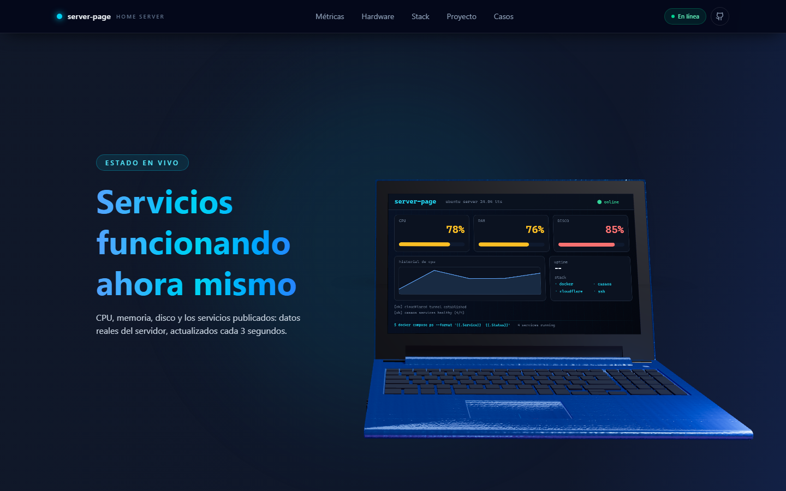
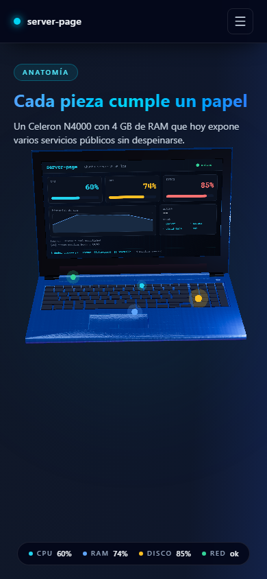

# server-page

**Un Acer Aspire 3 A315-42 reconvertido en servidor doméstico** (Ubuntu Server
24.04 LTS + Docker + túnel de Cloudflare), contado con una portada 3D real: el
portátil se abre, enciende la pantalla y enseña sus propias **métricas en
vivo** mientras haces scroll.



La pantalla del modelo no es una imagen pegada: el dashboard se dibuja en un
canvas y se proyecta **sobre el rectángulo real del LCD** del archivo 3D, con su
misma inclinación y su mismo marco. Y la tapa se mueve: empieza a medio cerrar
y se abre sola conforme advanced.

| Escritorio | Móvil |
| --- | --- |
|  |  |

## Qué hay dentro

- **Portada 3D scroll-driven** — escena real en three.js: la cámara encuadra
  el modelo calculando su silueta exacta, la tapa se cierra y se abre, y los
  hotspots marcan CPU, RAM, disco y red sobre la base. La composición cambia
  según la orientación: en horizontal el texto ocupa la columna izquierda y el
  modelo la derecha; en vertical el texto va arriba y el modelo debajo.
- **Métricas en vivo** — CPU, memoria, disco y uptime los publica FastAPI y se
  refrescan cada 3 s. Se ven a la vez en la pantalla del 3D y en la sección de
  gráficas, alimentados por un único `fetch` compartido.
- **Secciones** — métricas, hardware, stack tecnológico, propósito del
  proyecto y casos de uso, todas responsive (las fichas van a dos columnas en
  móvil).
- **Sin dependencias externas en tiempo de ejecución** — no hay HDR remotos ni
  fuentes externas: el entorno 3D se genera en local con `Lightformer`, así que
  la portada se ve igual sin conexión.

## Stack

| Capa | Tecnología |
| --- | --- |
| Frontend | React 19 + Vite 7 + Tailwind CSS 4 |
| 3D | three.js 0.180 + @react-three/fiber 9 + @react-three/drei 10 |
| Gráficas | Recharts 2 |
| Iconos | lucide-react |
| Backend | FastAPI + psutil (métricas del sistema y estado de los servicios) |
| Despliegue | Docker + nginx, con Dockploy (un push a `main` = despliegue) |

## Puesta en marcha

### 1. Frontend

```bash
npm install
npm run dev        # http://127.0.0.1:5173
```

### 2. Backend

El proxy de Vite manda `/api` a `http://127.0.0.1:8001` (ver
`vite.config.js`), así que en desarrollo el backend tiene que escuchar en el
**8001**:

```bash
# Opción A: con Docker (mismo puerto que publica docker-compose)
docker compose up -d backend

# Opción B: con uvicorn en local
cd backend
pip install -r requirements.txt
python -m uvicorn app.main:app --host 127.0.0.1 --port 8001
```

Comprobación: `curl http://127.0.0.1:8001/api/metrics`

### 3. Otros comandos

```bash
npm run build      # genera dist/
npm run lint       # ESLint
npm run preview    # sirve dist/ en local
```

## Estructura

```
server-page/
├── backend/                     API de métricas
│   ├── app/main.py              endpoints + lectura con psutil
│   └── Dockerfile
├── docs/                        capturas de la portada
├── public/
│   ├── models/laptop.glb        modelo 3D del portátil
│   └── laptop.webp              portada estática
├── src/
│   ├── components/
│   │   ├── three/               escena 3D
│   │   │   ├── choreography.js      cámara, rig y tapa en una sola curva
│   │   │   ├── Scene.jsx            luces, encuadre y coreografía
│   │   │   ├── Laptop.jsx           tapa, pantalla viva y LED de estado
│   │   │   ├── useLaptopParts.js    separa base/tapa y monta el panel del LCD
│   │   │   ├── ScreenTexture.js     dashboard dibujado en canvas
│   │   │   ├── laptopMaterials.js   materiales reales del equipo
│   │   │   └── LaptopCanvas.jsx     lienzo y calidad adaptativa
│   │   ├── ScrollStory.jsx      portada con scroll y capas de texto
│   │   ├── Nav.jsx              scroll-spy, estado en línea y menú móvil
│   │   └── ...                  resto de secciones (métricas, hardware…)
│   ├── hooks/useDeviceProfile.js  calidad según el dispositivo
│   ├── store/serverStore.js       estado de métricas compartido
│   └── styles/index.css
├── Dockerfile                    build multi-stage + nginx
├── docker-compose.yml
└── nginx.conf                    sirve dist/ y hace proxy a /api
```

## Endpoints del backend

| Ruta | Respuesta |
| --- | --- |
| `GET /api/metrics` | `{cpu, memory, disk, uptime}` — se refresca cada 3 s |
| `GET /api/status` | `{services: [{name, slug, url, online}]}` |
| `GET /api/services` | `{services: [...]}` — lista de servicios publicados |
| `GET /health` | `{status: "ok"}` |

## Cómo está montado el 3D

- **`choreography.js`** — una sola curva gobierna todo el recorrido: la pose de
  la cámara, el giro del rig y **el ángulo de la tapa**. La tapa se cierra un
  poco al entrar y se abre sola al hacer scroll, con un respiro mínimo
  proporcional a la carga de CPU.
- **`Scene.jsx`** — luces y encuadre. La distancia de cámara no es un número
  fijo: se calcula sobre las ocho esquinas reales del modelo, de modo que el
  portátil se ve entero y del mismo tamaño en un móvil que en un monitor 4K.
- **`useLaptopParts.js`** — separa base y tapa del GLB, calcula la bisagra y
  monta el panel de pantalla.
- **`ScreenTexture.js`** — dibuja el dashboard en un canvas 2D (1280×728, la
  proporción real del LCD) y lo sube como textura.
- **`laptopMaterials.js`** — materiales y colores reales del equipo, con mapas
  de metal cepillado.

Los textos y el indicador de scroll se actualizan **sin re-renderizar React**:
el progreso del scroll viaja por una `ref` y se lee dentro de `useFrame`.

### La pantalla, dentro de la pantalla

Los UV de la malla `display` del GLB son degenerados, así que el dashboard no
se puede mapear encima. En lugar de inventar un panel plano se localiza el
**rectángulo del LCD**: el triángulo más grande de la malla `display` es su
superficie útil, y sus vértices son las cuatro esquinas reales de la pantalla.
El panel se construye con esos mismos vértices, con la inclinación (15,7°) y
el marco originales, y el dashboard queda literalmente dentro.

### El modelo 3D

`public/models/laptop.glb` es un portátil low-poly con las piezas separadas por
materiales (`case`, `display`, `bezel`, `keyboard`, `touchpad`, `ports`,
`ethernet_port`, `holes`). Los nombres de nodo llegan saneados por el
cargador de glTF (`Cube.001_3` → `Cube_001_3`), así que la tapa se localiza
por jerarquía y no por nombre.

## Despliegue

```bash
docker compose up -d --build   # frontend en :8080 y backend en :8001
```

- `Dockerfile` — build multi-stage: Node 22 compila `dist/` y nginx lo sirve.
- `nginx.conf` — SPA con fallback (`try_files`) y proxy `/api/` → `backend:8000`.
- **Dockploy** — el repositorio es la fuente de verdad: cada push a `main`
  reconstruye la imagen y publica el sitio. No hay que tocar el pipeline.

## Variables de entorno

| Variable | Dónde | Para qué |
| --- | --- | --- |
| `HOST_TARGET` | backend | host al que se comprueban los puertos de los servicios (`host.docker.internal` en Docker) |

## Limitaciones conocidas

- **Las métricas son las del contenedor, no las del host**: `psutil` lee el
  `/proc` del contenedor. Para ver el consumo real del portátil habría que
  montar el `/proc` del host o consultar el socket de Docker.
- `npm run deploy` y `deploy_server.sh` son el camino de despliegue manual
  anterior a Dockploy; el habitual es el push a `main`.

## Créditos

- **Modelo 3D**: [Laptop](https://sketchfab.com/3d-models/laptop-676e365f61f544e9a0236b7519e1bc90)
  de [GeniusPilot2016](https://sketchfab.com/GeniusPilot2016), bajo licencia
  [CC BY 4.0](http://creativecommons.org/licenses/by/4.0/). Los colores y los
  materiales se recolorean con los del equipo real.
- **Iconos**: [Lucide](https://lucide.dev/), licencia ISC.
